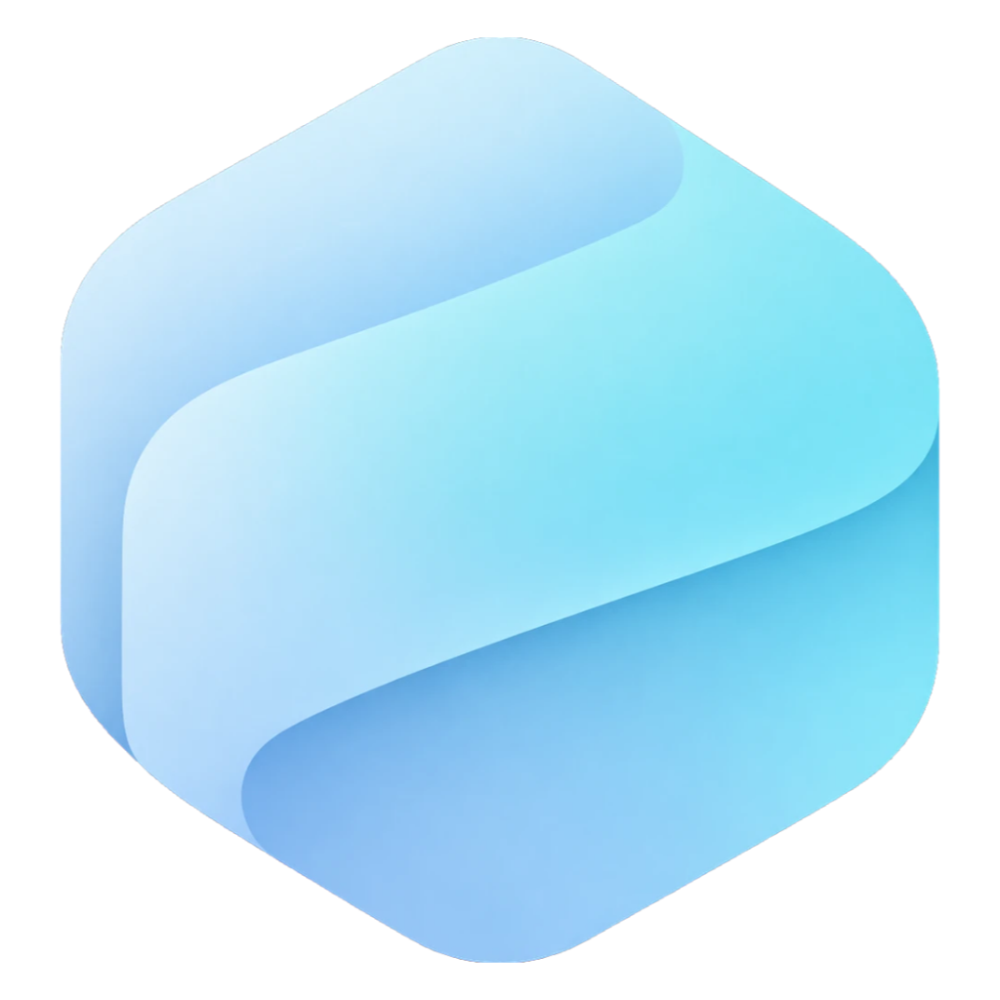

<p align="center"></p>

<h1 align="center">Deskbase</h1>

<p align="center">Your pages, tasks and notes as panels on the Windows desktop.</p>

## Install

Download `Deskbase-Setup-0.26.0.exe` from the [latest release](https://github.com/vptr-dev/deskbase/releases/latest), run it and follow the steps. If SmartScreen appears, choose **More info → Run anyway**. Deskbase updates itself.

## Wishlists and collections

Each Wishlist keeps its own categories and saved filters. Manage category order, colours and archives on the page. Edit an item for quantities, variants, price history, order details, receipts and gift notes. Reserve money from a non-resetting Value whose unit matches the wishlist currency. Other wishlists using the same Value share its balance.

Collections have field presets for films, games and books, and can also use your own statuses and fields. Import CSV rows using a mapping preview, record separate runs of one entry or group a series in order. Recently removed entries can be restored individually. Export previews let you choose which details leave the workspace.

## Planning and schedules

The repeat editor previews up to ten dates and supports excluded dates, rotations and intervals measured from completion. Move a task once to adjust its due date while keeping the series cadence. Task views can filter by energy, and subtasks can run independent timers.

Combine planners and connected calendars in one view. Use **View options** to set planning hours, travel durations and a rotating timetable. **Find shared free time** lists openings and copies selected meeting options. Cancelled feed events can become follow-up reminders with their notes intact.

## Workspaces, launchers and themes

Open **Desktop → Workspace settings** to choose a landing page, set quiet hours, save panel positions as an arrangement or archive a workspace. In a panel’s **Place** settings, preview its destination before moving it. Use **Also show in** to share one panel across selected workspaces.

Launchers can open shortcuts in sequence, open an alternate target, browse a local folder or show recently modified files with exclusions. Import Windows shortcuts through a preview. In **Appearance → Themes**, choose **Custom theme** to preview and save matching sidebar, page and panel styles.

## Editable pages and creative projects

Choose a tool under **New page** to start a document with that tool and a place to write. Use the block handle or right-click a block to insert above or below, save a snippet, compare paragraph revisions, or move the block by keyboard. Right-click the blank area at the end to append another tool.

Expand **Creative projects** in New page for shot lists, scene boards, asset registers, mood boards, reference sheets, sketch pairs, draft comparisons, experiments and voice ideas. Mood boards can sample colours from an imported image. A reference image accepts a rating from 0 to 5 while it has keyboard focus. Voice notes record up to one minute and support a typed summary.

## Named schedules and panel views

Save a schedule in the repeat editor to reuse its weekdays, interval and duration on another task or habit. Applying a schedule uses the new item's start date. Panel settings can save named views for each panel type, including the selected sources. Database views now include a local entry form. Workspace search includes collection items, flashcards, wishlist entries and results already loaded by active connections.

## Connecting accounts

The desktop connection editor offers browser authorization for supported account APIs. Use the callback address shown in Deskbase when registering the provider application. Some providers restrict redirects, require app approval or limit permissions by plan. Use the service's credential setup option if your organization uses access tokens. Trello lets you choose read-only or card-editing permission. Public feeds use their URLs, while Codex and Claude Code read local session data.

## Mail sign-in and themes

Under Connections, add Mail, choose Gmail or Outlook, enter your email address, and expand **Sign in through your browser**. Use a Google Desktop OAuth client ID and secret, or a Microsoft public desktop client ID configured for loopback redirects and delegated IMAP access. The provider asks for permission in your browser. Gmail also accepts an app password from an eligible Google account. Deskbase stores the authorization on the device. An inbox panel can mark individual messages read or unread.

Under Appearance, name your current theme and choose whether to include your desktop panel style. Apply a saved theme, edit its settings, and save under a second name to keep both versions.

## Study and tracking

Create a Study deck for each subject. Paste two columns of questions and answers, then review cards as they come due. List trackers support quantity targets, reading lists remember your page, and workout logs can repeat a previous session. Panels can share a named source or point to separate ones. Wishlist and Purchased use the same items, with category, priority, pictures, links and spending totals.

Under Settings → Data & backups you can import Markdown files, rename tags and enable a workspace password. Keep the password somewhere safe. JSON exports remain readable outside Deskbase.

## What's inside

- **Desktop panels** that live on the desktop like Rainmeter skins (no taskbar buttons, not in Alt+Tab): tasks, pages (or just today's part), clocks in many styles, world clock, timers, stopwatch, sunrise and sunset, weather, moon, system use, network speed, battery, calculator, recent pages, database charts, activity heatmap, deadlines, launcher, web search, study progress, table totals, month and more. Each has its own styles and parts to show or hide; set one up with a live preview before adding it. Move, resize, lock and group them.
- **Named lists and study decks**. Create a List tracker for quantities or reading progress, or a Study deck for question-and-answer cards. Review due cards by subject, reveal an answer and schedule another review. Pages, inline tools and widgets share the same records.
- **Wishlist galleries and purchases**. Filter wish cards by category, attach a picture or product link, and set priority and price. Purchased items share the same records and appear on a board with category totals.
- **Named planners and saved views**. Open To-do and choose **New planner** for a separate Work or Home list. Choose **Add view** to keep filters, sorting, grouping and visible fields in a named tab. Task panels can follow a saved view.
- **Reusable layouts**. Mark a page with **Use as a template**, then pick it in **New page**. For desktop panels, use **Desktop > Layout templates**. Choose linked lists to share updates or fresh lists to start independently.
- **Multi-step buttons**. Choose **Add step** in a button's settings. A purchase button can mark an item bought, deduct its price from a value and write a dated expense to a page. Undo reverses the data changes together.
- **Recurring tasks on panels**. Use the repeat icon next to **Add a task** to choose an interval, weekdays and an optional end date. Right-click a task to edit its schedule.
- **Wishlist and purchases**. Add a Wishlist page, insert one into a document or select it in a desktop or dashboard widget. Enter prices, track a budget and move items between Wishlist and Purchased.
- **Tracker panels**. Pick a tracker such as water or calories and log directly to the same history as the tracker page.
- **Custom buttons**. Insert a button on a page, add a button panel or enable **Custom button** in another widget. Buttons can reveal a toggle, change or set a value, add to-dos, create a task, or open a page or link.
- **Widget actions**. Right-click a panel for actions on the selected item, followed by widget actions and desktop controls. Locked panels still support task entry, timer controls and connection actions. Save a feed item to a page, turn it into a task or embed a live widget with **Embed widget in page**. Type `/linked widget` in a document to choose an existing widget.
- **Panel locking**. Lock a panel from its right-click menu. Its content stays interactive. Open **Desktop** to unlock panels.
- **Workspaces**, each with its own panel layout.
- **Appearance**: glass, blur, frosted or solid, light and dark, borders, fonts, text tone and colors, with its own section for the desktop panels.
- **Application menu** in the upper-left corner for files, editing, views, history, windows and keyboard shortcuts.
- **Inline tools** on normal pages. Use **Insert block** for a tool, tabs or up to 12 columns. Drag blocks between sections or use **Add to a normal page** on an existing tool. Type `/planner` for a calendar, `/tasks` for a to-do list, or `/existing tool` to work with a tool you already use. Place notes, headings and tools together inside pages, columns or tabs.
- **Projects** with local tasks and linked Trello boards. Create cards and move them between lists. Tasks and habits support custom repeat intervals and weekdays.
- **Pages** in tabs, with a formatting bar (colors and highlight), reminders from dates in the text, columns, tabs blocks, inline databases, toggle headings, links between pages, backlinks, bookmarks, images, embeds, equations, buttons and synced blocks.
- **Page history and templates** for pages and database rows.
- **Assistant** in a side panel (Ctrl J) or a page of its own: chats with history, a provider and model per chat (Ollama, LM Studio, Anthropic, OpenAI, Gemini, OpenRouter), roles, and access from read-only to making changes with undo.
- **Connection panels** for 34 additional services including Trello, Asana, Linear, ClickUp, Slack, Dropbox, Figma and research catalogs. Set the source, row count, summaries and text filter per panel. Codex CLI and Claude Code panels read recent local session indexes and copy resume commands. Account connections require credentials from the provider.
- **Connections**: Google, Outlook and Apple calendars, mail (IMAP), Todoist, RSS feeds, GitHub issues and pull requests, and Notion pages and databases kept in sync, with panels for each, plus a Now playing panel.
- **To-dos, databases** (relations, rollups, formulas; table, board, gallery, list, calendar, timeline and chart views), **habits, journal and goals**, with **Notion import** that keeps tabs, columns, colors, formatting and real databases with their views.

## Your data

Everything stays on your computer in `%APPDATA%\Deskbase\data`, saved automatically with daily backups. Weather panels look up only the place you set; bookmarks and embeds load only the addresses you add. The assistant sends a chat only to the provider that chat uses; local models keep it on this computer. Connections talk only to the services you add.

## Development

```bash
npm install
npm run dev        # app with hot reload
npm run dev:web    # UI only, in a browser
npm run typecheck
npm run release -- patch   # or minor / major
```

## License

MIT
